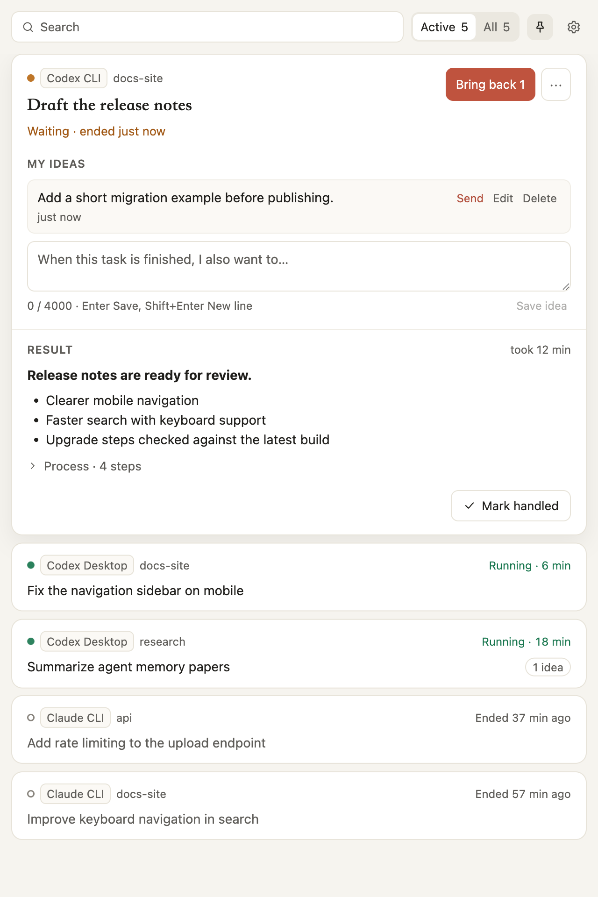
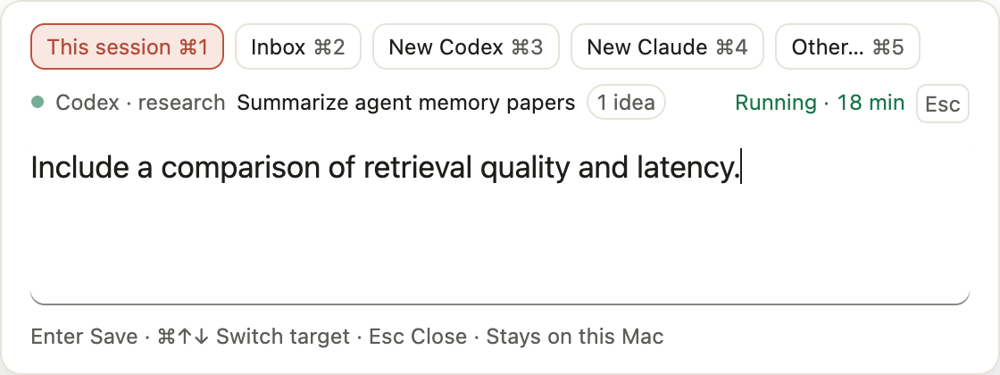
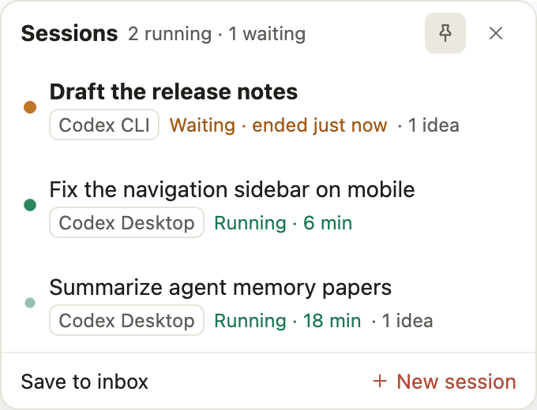

# AimSpan｜意成

**Keep your train of thought while Claude Code and Codex agents work.**

[简体中文](README.zh-CN.md)

AimSpan is a macOS companion for people running several long agent sessions. Keep working in your existing apps; AimSpan helps you pick up where you left off.

## What it does

1. **See what is active.** The menu bar, session panel and floating bubble show sessions that are running or waiting for you.
2. **Capture ideas in seconds.** Press **⌘⇧Space** to save an idea to a session or the inbox while an agent works.
3. **Catch up when you switch back.** Open a catch-up card to see results and recent activity alongside your saved ideas. Bring ideas back by copying them to the clipboard and opening the native app; you paste and send them yourself.





## Supported sources

| Agent | Sources |
| --- | --- |
| Claude Code | Claude desktop app's Code tab, CLI, VS Code |
| Codex | Desktop app, CLI, VS Code |

AimSpan reads these tools' local records. Native formats can change; see [verification status and known limits](docs/STATUS.md) for what has actually been tested. Exact native-session opening and some macOS interactions still need real-app verification.

## Privacy

AimSpan works locally: no account, no model calls and no telemetry. It reads `~/.claude` and `~/.codex` **read-only**, without installing hooks or changing agent configuration. Observations are bounded and redacted; AimSpan does not keep a full transcript copy. Your ideas are stored verbatim on your Mac.

AimSpan never sends to an agent. Bringing ideas back requires an explicit action and only copies text to the clipboard and opens the native app. See the [data-handling design](docs/SECURITY.md).

## Install

Visit [GitHub Releases](https://github.com/Asxing/aimspan/releases) for a macOS download when a release is available. Unzip the download, move `AimSpan.app` to Applications and open it. If there is no release asset yet, build from source below.

Current local bundles are ad-hoc signed and **not notarized**. If macOS blocks the first launch, right-click `AimSpan.app`, choose **Open**, then confirm **Open**. Automatic updates are not implemented.

## Build from source

Use macOS, **Node.js ≥22.19** and **pnpm 11.24.0** (pinned in `packageManager`). With Corepack available:

```bash
corepack enable
corepack prepare pnpm@11.24.0 --activate
pnpm install
pnpm build
pnpm dev
```

Run the checks or create a local app bundle:

```bash
pnpm verify
pnpm verify:smoke
pnpm package:local-mac
```

The bundle is written to `apps/desktop/release/AimSpan.app`. Quit any running copy of that bundle before rebuilding it; closing the panel does not quit the menu-bar app.

## Documentation and contributing

- [Product](docs/PRODUCT.md): behavior and interface scope.
- [Architecture](docs/ARCHITECTURE.md): processes, modules and native source formats.
- [Core protocol](docs/CORE-PROTOCOL.md): requests and projections.
- [Security design](docs/SECURITY.md): authority, local data and recovery.
- [Status](docs/STATUS.md): measured results and unverified behavior.
- [Roadmap](docs/ROADMAP.md): unfinished work.
- [Contributing](CONTRIBUTING.md): setup, checks and repository rules.
- [Report a vulnerability](SECURITY.md): private security reporting.

## License

[MIT](LICENSE) · Copyright (c) 2026 Asxing.
