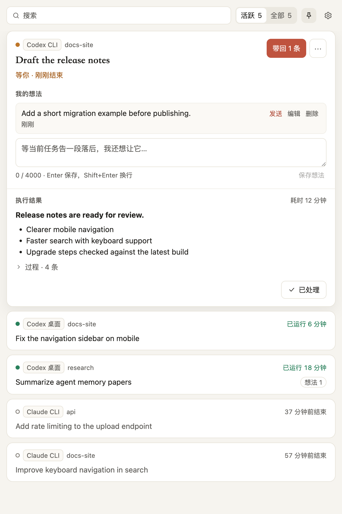

# AimSpan｜意成

**Claude Code 和 Codex Agent 执行任务时，帮你保持思路。**

[English](README.md)

AimSpan 是一款 macOS 伴随工具，适合同时运行多个长程 Agent 会话的人。你继续在原有 App 中工作，AimSpan 帮你切回时接上思路。

## 它做什么

1. **知道哪些会话活跃。** 菜单栏、会话面板和悬浮气泡显示正在运行或等你处理的会话。
2. **几秒内记下想法。** Agent 工作时，按 **⌘⇧Space**，把想法记到某个会话或收件箱。
3. **切回时顺利衔接。** 打开衔接卡，把执行结果、最近动态和保存的想法一起看。带回想法时会复制到剪贴板并打开原生 App，粘贴与发送由你完成。




## 支持的来源

| Agent | 来源 |
| --- | --- |
| Claude Code | Claude 桌面 App 的 Code 页签、CLI、VS Code |
| Codex | 桌面 App、CLI、VS Code |

AimSpan 读取这些工具的本地记录。原生格式可能变化；实际测过的行为以[验收状态与已知限制](docs/STATUS.md)为准。精确打开原生会话以及部分 macOS 交互仍需在真实 App 中验证。

## 隐私

AimSpan 仅在本机工作：无需账号、不调用模型、不收集遥测。它**只读** `~/.claude` 和 `~/.codex`，不安装 Hook，不修改 Agent 配置。观察记录有大小限制并经过脱敏，不保存完整会话副本。你写下的想法原样保存在 Mac 上。

AimSpan 从不向 Agent 发送内容。带回想法需要你明确操作，只会复制文字到剪贴板并打开原生 App。详见[数据处理设计](docs/SECURITY.md)。

## 安装

发布版本可用后，可从 [GitHub Releases](https://github.com/Asxing/aimspan/releases) 下载 macOS 应用。解压后把 `AimSpan.app` 移到“应用程序”并打开。如果还没有发布附件，请按下文从源码构建。

当前本地应用包采用 ad-hoc 签名，**尚未公证**。如果 macOS 阻止首次启动，请右键点击 `AimSpan.app`，选择“打开”，再确认“打开”。目前没有自动更新。

## 从源码构建

需要 macOS、**Node.js ≥22.19** 和 **pnpm 11.24.0**（由 `packageManager` 固定）。在 Corepack 可用的环境中运行：

```bash
corepack enable
corepack prepare pnpm@11.24.0 --activate
pnpm install
pnpm build
pnpm dev
```

运行检查或生成本地应用包：

```bash
pnpm verify
pnpm verify:smoke
pnpm package:local-mac
```

产物位于 `apps/desktop/release/AimSpan.app`。重新打包前先退出正在运行的这个应用包；关闭面板不会退出菜单栏应用。

## 文档与贡献

- [产品](docs/PRODUCT.md)：行为与界面范围。
- [架构](docs/ARCHITECTURE.md)：进程、模块与原生记录格式。
- [Core 协议](docs/CORE-PROTOCOL.md)：请求与投影。
- [安全设计](docs/SECURITY.md)：权限、本地数据与恢复。
- [状态](docs/STATUS.md)：实测结果与未验证行为。
- [路线图](docs/ROADMAP.md)：尚未完成的工作。
- [贡献指南](CONTRIBUTING.md)：开发环境、检查与仓库规则。
- [报告漏洞](SECURITY.md)：私密安全报告方式。

## 许可

[MIT](LICENSE) · Copyright (c) 2026 Asxing。
